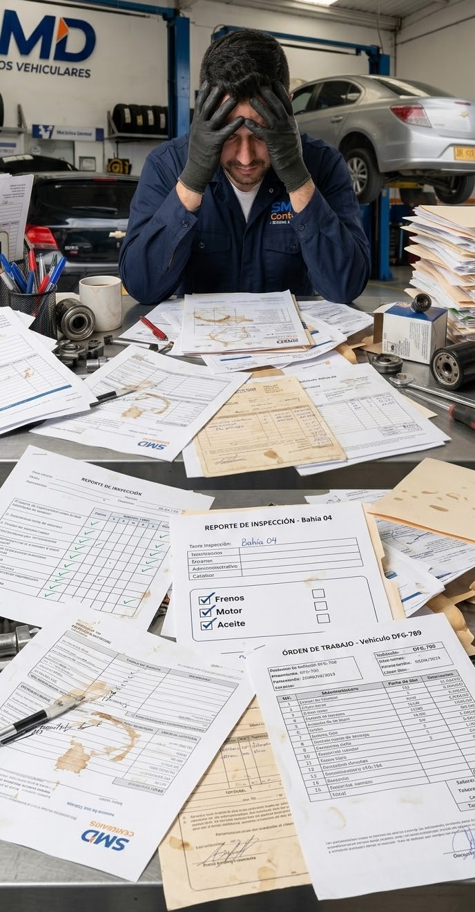

En SMD Servicios Vehiculares el control se hacía como en muchos talleres: a mano, en hojas sueltas, con prisas y grasa en los dedos.

El problema no era falta de ganas. Era que el papel no aguanta el ritmo del taller.

## El problema: el papel no aguanta el taller

Esto era lo normal antes de la app:

* Formatos largos de inspección que nadie alcanzaba a llenar entre carro y carro.
* Hojas manchadas, mojadas o perdidas. Si se perdía la hoja, se perdía la historia del carro.
* Nadie sabía rápido qué carro entró, en qué bahía está, qué se le revisó ni qué le falta.
* El mecánico perdía tiempo escribiendo en vez de estar revisando.

En hora pico, con varios carros en elevadores, ese papeleo se vuelve un cuello de botella.

## La solución: SMD Control en el celular

Construí **SMD Control**, una app móvil para registrar la entrada y salida de vehículos y llevar la trazabilidad de cada revisión, directo desde el celular y en segundos.

Lo que ve el mecánico es simple, como debe ser en taller:

* **Detalle de Inspección por carro:** Frenos, Motor, Ruedas, Exterior, Carrocería.
* **Checklist tocable:** Bueno / Regular / Malo, con un tap. Sin escribir párrafos.
* **Trazabilidad por vehículo:** qué se revisó, quién lo revisó, en qué bahía y cuándo.
* **Entrada y salida claras:** se acabó adivinar dónde está cada carro.

La foto de portada es la app en uso real: el mecánico con guantes, en plena bahía, revisando el detalle en el teléfono. Cero escritorio, cero papeles.

## Por qué le sirve al taller

1. **Velocidad donde importa.** Lo que antes eran 10 minutos de formato, ahora son 30 segundos de checklist.
2. **Evidencia, no memoria.** Si un cliente pregunta "¿cómo entró mi carro?", hay registro con fotos y estados, no "creo que...".
3. **Historial buscable.** Placa, bahía, fecha. Todo queda guardado y se puede consultar después.

## Detrás, sin humo

Para que jale en taller real la app tenía que ser rápida y aguantar fotos:

* **React Native** para la app que usan los mecánicos en Android/iOS.
* **FastAPI + Python** para la API.
* **Redis** para que las consultas frecuentes vuelen.
* **Cloudflare R2** para guardar las fotos de evidencia sin matar el servidor.

Nada exótico. Tecnología probada, puesta al servicio del taller.

---

Pasar de papeles a app no fue solo "modernizar". Fue quitarle al mecánico un dolor de cabeza para que haga lo que mejor sabe hacer: revisar carros.

Gracias por leer.

**deidev :)**
