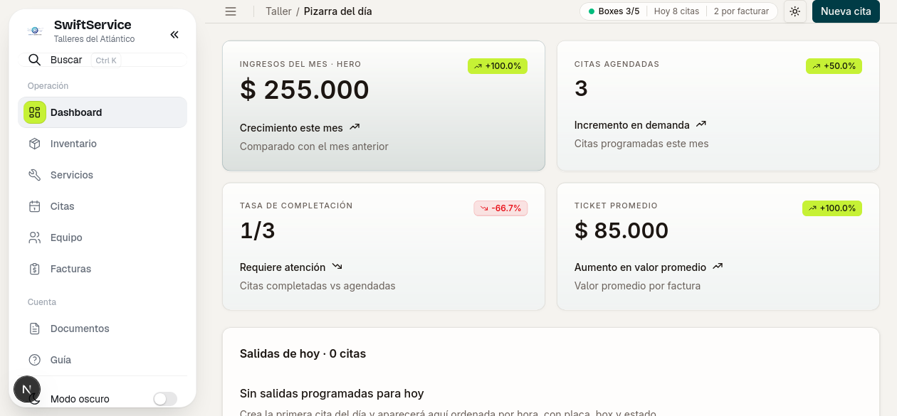
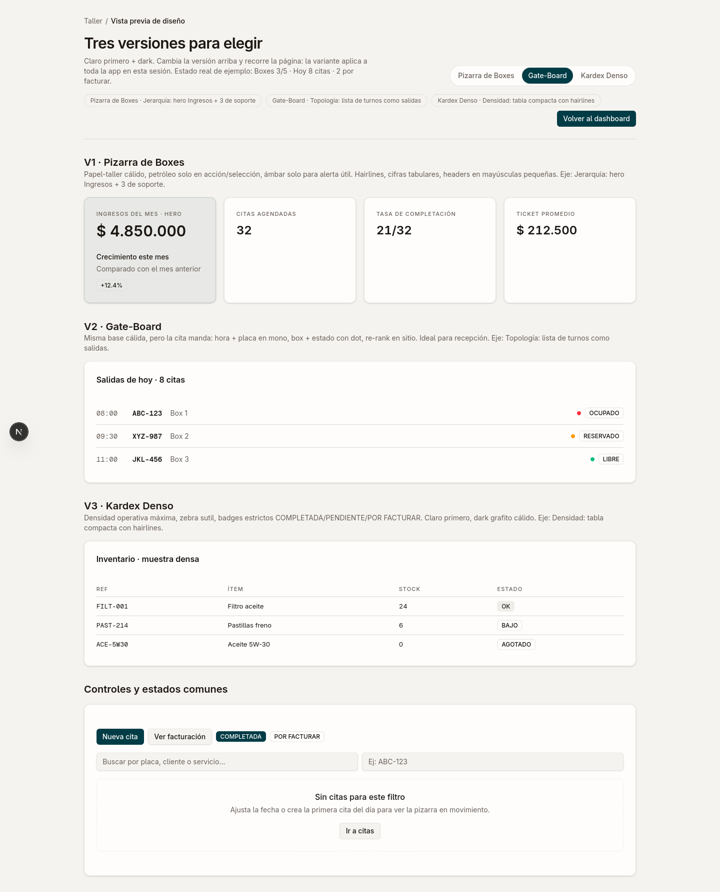
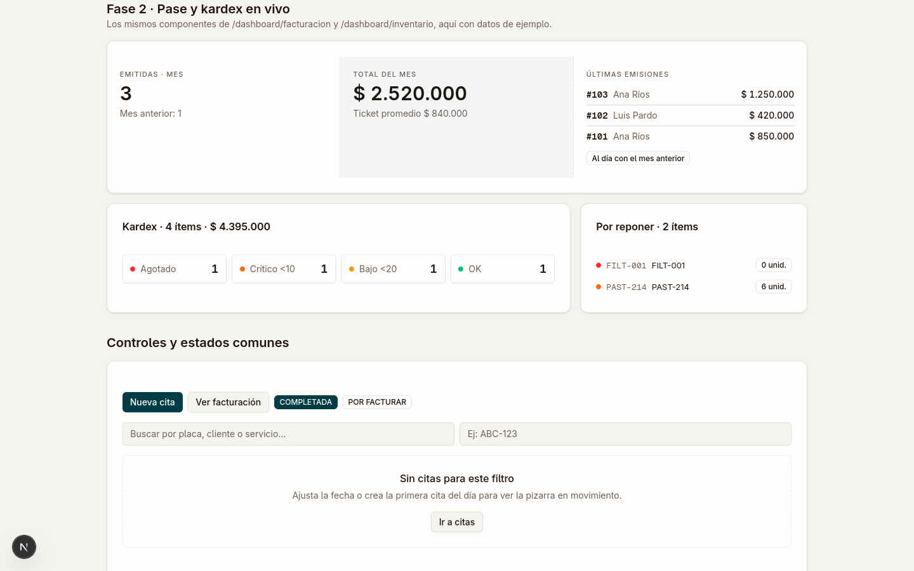

Mi cliente no tenía un problema de clientes. Tenía un problema de orden.

Las citas en un lado, el inventario en otro, la cuenta de cobro después — si se hacía. Cada carro que entraba dejaba plata sobre la mesa por simple desorganización.

Ahí nació **SwiftService**, el sistema administrativo que construí junto a mi compañero [Jhoni-dev](https://github.com/Jhoni-dev) para **Talleres del Atlántico**: una sola pantalla para operar todo el día.

## El problema: el taller perdía plata sin darse cuenta

Esto era lo normal antes del sistema:

* Citas anotadas sin estados claros. Nadie sabía qué estaba pendiente, completado o por cobrar.
* Inventario sin control real: filtros, pastillas y aceites se acababan justo cuando se necesitaban.
* Cobro desconectado del servicio. Se hacía el trabajo, pero la cuenta se atrasaba o se perdía.
* Cero métricas. Sin saber ingresos del mes, ticket promedio ni tasa de completación, es imposible decidir.

No era falta de trabajo. Era fuga por todos lados.

## La solución: una pizarra para operar el día

Diseñé el dashboard como una **pizarra del día**, no como un admin genérico. Lo primero que ve el taller al abrir es lo que importa hoy:

* **Ingresos del mes + crecimiento** comparados con el mes anterior.
* **Citas agendadas, tasa de completación y ticket promedio** en COP.
* **Salidas de hoy:** hora + placa + box + estado (Ocupado / Reservado / Libre), ordenadas por hora.
* Flujo cerrado: **cita → servicio → comprobante**, sin fricción y con trazabilidad.

Para llegar a ese diseño probé tres versiones con datos reales — Pizarra de Boxes, Gate-Board y Kardex Denso — y me quedé con lo que la recepción realmente usa:

## Lo que el sistema hace todos los días

* **Citas:** calendario + tabla densa, búsqueda por placa, cliente o servicio, estados COMPLETADA / PENDIENTE / POR COBRAR.
* **Clientes y vehículos:** historial por carro para responder "¿cómo entró?" sin adivinar.
* **Inventario con kardex:** stock, estados OK / Bajo / Agotado y alertas de reposición. Si hay 0 unidades de FILT-001, se ve antes de que duela.
* **Servicios y comprobantes:** del trabajo hecho al comprobante interno con base en el gasto, con ticket promedio visible. Aclaro: no es facturación oficial, es un soporte interno — aún no facturo legalmente.
* **Documentos:** exportación directa a PDF y Excel para control interno y revisiones.
* **Equipo y roles:** ADMINISTRADOR, recepción y taller, cada quien ve lo que le toca. Más login con recuperación de contraseña y modo claro/oscuro para oficina y boxes.

La parte de cuentas y repuestos se ve así en vivo:

> Nota: lo que ves como "facturación" en las capturas son comprobantes internos de cobro, no facturas oficiales. Sirven como soporte del gasto hecho.

## Por qué le sirve al taller

1. **Cierra la fuga.** Todo lo que se agenda se completa y se cobra con su comprobante. Nada se queda en "luego lo cobro".
2. **Decide con números.** Ingresos, citas, completación y ticket promedio en tiempo real, en español y en COP.
3. **Opera más rápido.** Tablas densas, estados siempre visibles, una sola búsqueda por placa. Menos clics, más carros.

## Detrás, sin humo

Para aguantar operación diaria intensiva en desktop:

* **Next.js 15 + React 19** con Tailwind, shadcn/Radix, TanStack Query/Table y Recharts.
* **Backend en Go con Gin + GORM + Postgres** real: citas, clientes, inventario, comprobantes y auth con JWT.
* **Cloudflare R2** para las fotos de evidencia.
* Formularios con React Hook Form + Zod, tests con Vitest y suite en `test/` (api, contrato, e2e).

Nada improvisado. Arquitectura de producto real, con el vocabulario del taller: citas, boxes, placas, comprobantes.

---

Pasar de cuaderno y memoria a pizarra en vivo no solo ordenó el taller. Le devolvió la plata que se le escapaba por desorden.

Este proyecto lo sacamos adelante entre dos: mi compañero [Jhoni-dev](https://github.com/Jhoni-dev) y yo. Crédito compartido donde es debido.

Gracias por leer.

**deidev :)**
